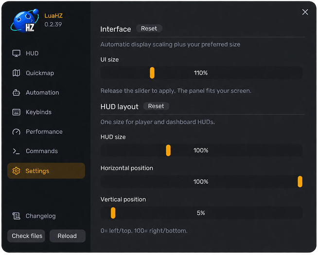
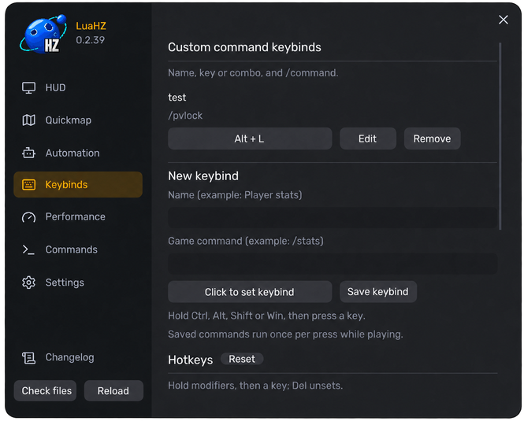
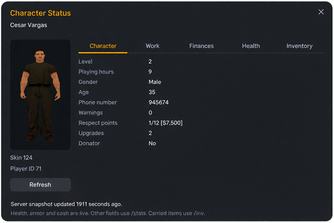
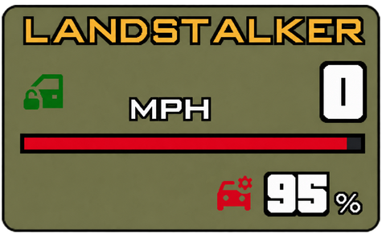

<div align="center">

# LuaHZ

<p align="center">
  
</p>

<p align="center">
  <a href="https://github.com/DedSecLabs/luahz/releases/tag/v0.2.39-player"></a>
  
  <a href="https://github.com/DedSecLabs/luahz/actions/workflows/release.yml"></a>
  <a href="LICENSE"></a>
</p>

<p align="center">
  <b>A modern HUD and quality-of-life toolkit for Horizon Roleplay.</b>
</p>

<br>

<p align="center">
  
</p>

It activates only on `samp.hzgaming.net:7777` / `213.32.6.232:7777`. The same SA-MP installation can still join other servers.

[Download](https://github.com/DedSecLabs/luahz/releases/tag/v0.2.39-player) · [Install](#install) · [Controls](#controls) · [Features](#features) · [Development](#development)

</div>

---

## Install

Download **[LuaHZ-0.2.39-player.zip](https://github.com/DedSecLabs/luahz/releases/download/v0.2.39-player/LuaHZ-0.2.39-player.zip)**.

### 1. Prepare the game

Start with classic **GTA San Andreas 1.0 US** and **SA-MP 0.3.7 R5**. Connect to Horizon once before adding mods.

Close **GTA and the SA-MP browser** before copying files. Your **GTA folder** is the folder that contains `gta_sa.exe`.

### 2. Install the prerequisites

Install these **in order**, with GTA and SA-MP closed. Use the named **32-bit (x86)** versions even on 64-bit Windows. Open each ZIP and copy its runtime files to the destination below. Keep the complete supplied libraries.

| Download — tested version | Where it goes |
|---|---|
| **1. SA-MP 0.3.7 R5** — [Download](https://hzgaming.net/fullpage.php?id=download). Choose `R5-2-MP`. | Run the installer and select your **GTA folder**. `samp.exe` and `samp.dll` should sit beside `gta_sa.exe`. |
| **2. CLEO 4.4.4 + ASI loader** — [Download](https://github.com/cleolibrary/CLEO4/releases/download/v4.4.4/CLEO4.zip) | Follow the ZIP's README. Use its supplied **Silent's ASI Loader 1.2** (`vorbisFile.dll` and `vorbisHooked.dll`) in your **GTA folder**. |
| **3. MoonLoader 0.26.5-beta** — [Download](https://blast.hk/moonloader/download.php?archive) | Extract the runtime into your **GTA folder**. Keep `MoonLoader.asi`, the supplied DLLs, and the complete `moonloader/lib` folder. |
| **4. SAMPFUNCS 5.7.1 rel.25, R5 build** — [Download](https://www.blast.hk/attachments/255877/) | Put `SAMPFUNCS.asi` in your **GTA folder**. Use the **R5** build. |
| **5. mimgui 1.7.0** — [Download](https://github.com/THE-FYP/mimgui/releases/download/v1.7.0/mimgui-v1.7.0.zip) | Merge its library into **`moonloader/lib`**. `moonloader/lib/mimgui/init.lua` and `mimgui/cimguidx9.dll` should exist. |

On **Linux/Wine**, install the prerequisites inside the **same Wine prefix** as this game copy. If Windows asks for missing DirectX or Visual C++ files, use Microsoft's [DirectX June 2010 package](https://www.microsoft.com/en-us/download/details.aspx?id=8109) and [Visual C++ x86 runtime](https://aka.ms/vc14/vc_redist.x86.exe).

### 3. Add LuaHZ

Close GTA and the SA-MP browser. Extract the player ZIP outside the GTA folder.

**Windows:** merge `payload/moonloader` into the GTA `moonloader` folder. Copy `payload/LuaHZLoading.asi` next to `gta_sa.exe`.

**Linux/Wine:** from the extracted folder, run:

```sh
bash install.sh "/path/to/GTA San Andreas"
```

The path must contain `gta_sa.exe`.

### 4. Join Horizon Roleplay

Add `samp.hzgaming.net:7777` in the SA-MP browser and connect. A LuaHZ notice appears at the **bottom right**.

## Features

| Area | What LuaHZ adds |
|---|---|
| HUD | Player information, stamina and oxygen, vehicle speed and health |
| Quickmap | Saved Horizon locations and a configurable map |
| Character Status | Skin portrait, live player information, and tabbed server statistics |
| Controls | Editable shortcuts, custom command bindings, and cruise control |
| Performance | FPS limits for different game contexts |
| Horizon helpers | Ordinary server commands, offer handling, and tracking tools |
| Visuals | Special game loading artwork, high quality fonts, game map, radar map and map blips |

## Controls

| Control | Action |
|---|---|
| **F9** or `/luahz` | Open settings |
| **M** | Open Quickmap |
| **I** | Open Character Status |
| **X** | Toggle cruise control at your current speed |
| **Numpad + / −** or **= / −** | Raise or lower the cruise target by 1 mph |
| **Numpad 1 / 2 / 3** | Cruise at **50 / 80 / 120 mph** |

> Change shortcuts and preset speeds in **Settings → Hotkeys**. Cruise works while you drive a road vehicle. Brake, or press **X** again, to cancel.

### Settings: Press F9 or type `/luahz`.
<br>

### Keybinds: Custom keybinds for your needs.
<br>

### Character Status: Skin portrait and tabbed server statistics.


### Map: Quickmap with saved locations. Press `M`, or `Escape`, to close it.
<br>

### Map: High quality game map and map blips with saved locations.
<br>

### Map: High quality radar map and map blips.
<br>

### HUD: Vehicle name, speed, and health.
<br>

### HUD: Player stamina status.
<br>

### HUD: Player oxygen status.
<br>

## Other servers
On any other server, LuaHZ menus, HUD, and custom visuals stay inactive. Original game and plugin files remain stock on disk.

## Development
Source checks need **Python 3.11+**, **LuaJIT 2.1**, and **GCC**:

```sh
python3 -m venv .venv
.venv/bin/python -m pip install -r requirements-dev.txt
.venv/bin/python tools/check.py --luajit /path/to/luajit
```

Build and deploy steps are in [development](docs/DEVELOPMENT.md). GitHub's automatic source ZIP is this repository, not the player download.

## Documentation

| Guide | Purpose |
|---|---|
| [Installation](docs/INSTALLATION.md) | Prerequisite layout and troubleshooting |
| [Recovery](docs/RECOVERY.md) | Restore a previous installation |

## License and acknowledgments

Original LuaHZ code is [MIT licensed](LICENSE). The mimgui adapter and Lucide icons retain their upstream notices. External software and artwork retain their own terms. See [third-party notices](THIRD_PARTY.md).

LuaHZ is an independent project informed by the visible LunaHZ feature baseline. No affiliation with Horizon Gaming, Rockstar Games, SA-MP, or the prerequisite authors is implied.

## Support

If you find this project or any of my open-source work helpful, consider supporting future development:

- 💖 [Sponsor on GitHub](https://github.com/sponsors/amir0ff)
- ☕ [Buy me a coffee on Ko-fi](https://ko-fi.com/amir0ff)
